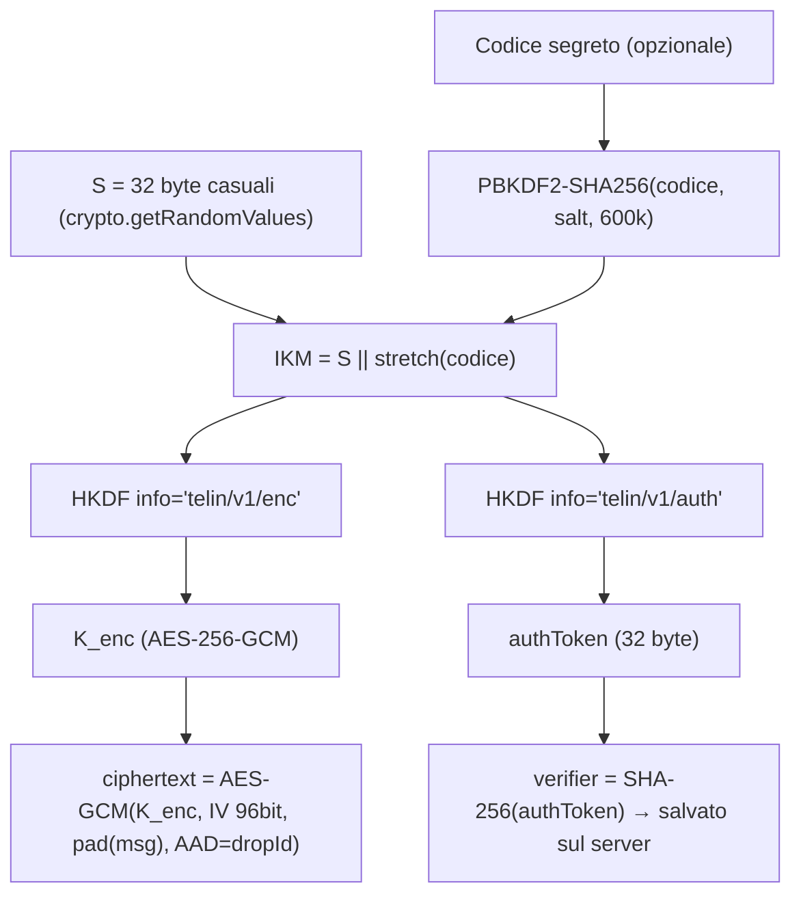

# TELIN — Piano di architettura e sicurezza

> **Principio guida:** *THE SERVER STORES DATA, NOT KNOWLEDGE.*
> Flusso utente: **SCRIVI → PROTEGGI → CONDIVIDI → LEGGI → SCOMPARE**

---

## 1. Stack proposto (e perché)

| Livello | Scelta | Motivazione |
|---|---|---|
| Framework | **Next.js 15 (App Router) + React + TypeScript** | Frontend e API nello stesso progetto, deploy semplice, middleware per CSP con nonce e header di sicurezza. |
| Styling | **Tailwind CSS v4** + poche classi custom (scanline, glow, glitch) | Richiesto da te; v4 non richiede config JS. |
| Crittografia | **Web Crypto API** nativa del browser (AES-256-GCM, HKDF-SHA-256, PBKDF2-SHA-256) | Primitive standard, implementate dal browser, zero dipendenze crittografiche di terze parti. |
| Database | **SQLite** (default, zero setup) con adapter **PostgreSQL** attivabile via `DATABASE_URL` | Sul tuo PC non ci sono né Docker né Postgres: SQLite permette di avviare tutto subito; in produzione si passa a Postgres senza cambiare codice applicativo. |
| Rate limiting | In-memory (default) con adapter **Redis** opzionale via `REDIS_URL` | Funziona su singola istanza; Redis serve solo se scali su più istanze. |
| Cleanup | Sweeper periodico lato server + cancellazione "lazy" a ogni accesso | I drop scaduti spariscono anche se nessuno li richiede. |

---

## 2. Modello di sicurezza

### Cosa il sistema protegge
- **Il server (e chi ne ruba il DB) non può leggere i messaggi**: riceve solo ciphertext; la chiave vive nel *fragment* dell'URL (`#...`), che i browser **non inviano mai** al server.
- **Chi conosce solo l'ID del drop** (es. da log, proxy) **non può né leggerlo né "bruciarlo"**: serve un token di accesso derivato dal segreto nel fragment.
- **Chi ha il link ma non il codice segreto** ha al massimo **5 tentativi**, poi il drop si autodistrugge.
- **Lettura singola atomica**: il ciphertext viene rilasciato e cancellato nella stessa transazione → impossibile aprirlo due volte (anche con richieste parallele / replay).

### Cosa il sistema NON può garantire (dichiarato anche nell'app)
> [!WARNING]
> - **Screenshot, foto, copia**: una volta mostrato, il destinatario può sempre conservare il messaggio.
> - **Server attivamente compromesso**: chi controlla il server può servire JavaScript modificato che ruba la chiave. È il limite di *ogni* app di cifratura web. Mitigazioni: CSP rigida, build riproducibile, hosting affidabile.
> - **Furto del link**: chi intercetta il link (senza codice) può leggere il messaggio prima del destinatario. Il mittente lo scoprirebbe solo perché il destinatario troverà "DROP EMPTY". Per questo esiste il CODICE SEGRETO su canale separato.
> - **Dispositivo/browser compromesso** (malware, estensioni malevole): può leggere tutto ciò che vede l'utente.
> - **Codice a 6 cifre** = ~20 bit di entropia: è sicuro **solo** grazie al limite di tentativi lato server, non contro un attaccante che possiede link + ciphertext rubato dal DB (attacco offline, rallentato ma fattibile).
> - **Errore di rete durante l'apertura** di un drop monouso: il messaggio è già stato consumato e va perso (scelta deliberata: sicurezza > recuperabilità).

### Analisi minacce → mitigazioni

| Minaccia | Mitigazione |
|---|---|
| XSS | React renderizza il messaggio solo come testo (mai `dangerouslySetInnerHTML`); CSP con nonce per-richiesta, `script-src 'self' 'nonce-…' 'strict-dynamic'`, niente script esterni. |
| CSRF | Nessun cookie/sessione → nessuna autorità ambientale da sfruttare. In più: API solo `application/json` + controllo `Origin`. |
| Brute force codice | 5 tentativi per drop → distruzione; rate limit per IP (IP solo hashato in RAM, mai su disco); PBKDF2 600k iterazioni lato client. |
| Replay | Lettura e cancellazione atomiche; token di accesso inutile dopo il consumo. |
| Enumerazione ID | ID da 128 bit casuali (`crypto.randomBytes`), risposta identica per "inesistente / scaduto / consumato", rate limit su lookup. |
| Leak del DB | Il DB contiene solo ciphertext + verificatori hashati. Senza fragment: inutile. |
| MITM | Solo HTTPS + HSTS (preload) in produzione. |
| Leak del link via Referer/history | `Referrer-Policy: no-referrer`; il fragment viene rimosso dalla barra indirizzi con `history.replaceState` appena letto. |
| Analisi lunghezza messaggio | Padding del plaintext a blocchi da 256 byte prima della cifratura. |
| Log | Nessun log applicativo di IP/User-Agent/ID drop; nessun analytics. |

---

## 3. Sistema di cifratura e gestione chiavi

**Creazione (browser del mittente)**
1. Genera `S` (256 bit) e `salt` (128 bit).
2. Se c'è il codice: `stretch = PBKDF2-SHA256(codice, salt, 600 000)`; altrimenti vuoto.
3. Deriva con HKDF due chiavi indipendenti: `K_enc` e `authToken`.
4. Chiede al server un `dropId`, cifra `pad(messaggio)` con AES-256-GCM (IV casuale, `dropId` come AAD → il ciphertext non può essere spostato su un altro ID).
5. Invia al server: `ciphertext, iv, salt, verifier = SHA-256(authToken), hasCode, lifetime`.
6. Link: `https://host/d/<dropId>#<S in base64url>` — **`S` non lascia mai il browser verso il server.**

**Apertura (browser del destinatario)**
1. Legge `S` dal fragment e lo rimuove dalla barra indirizzi.
2. Chiede i metadati pubblici (`hasCode`, `salt`, tipo di scadenza) — senza ciphertext.
3. Se serve, chiede il codice; ricalcola `authToken` e lo invia.
4. Il server confronta `SHA-256(authToken)` con il verifier (tempo costante):
   - OK → restituisce ciphertext e, se monouso, **lo cancella nella stessa transazione**.
   - KO → `failed_attempts++`; a 5 il drop viene distrutto.
5. Il browser decifra con `K_enc`. GCM garantisce anche integrità (se il server altera il ciphertext, la decifratura fallisce).

**Cosa sa il server:** che un drop esiste, la sua dimensione (arrotondata), scadenza, se ha un codice. **Non sa:** contenuto, chiave, codice, chi è mittente o destinatario.

---

## 4. Database (tabella unica `drops`)

| Campo | Tipo | Note |
|---|---|---|
| `id` | TEXT PK | 128 bit casuali, base64url (22 caratteri) |
| `ciphertext` | BLOB/BYTEA | NULL dopo il consumo |
| `iv` | BLOB | 12 byte |
| `salt` | BLOB | 16 byte (per PBKDF2/HKDF) |
| `verifier` | BLOB | SHA-256(authToken) |
| `has_code` | BOOL | |
| `mode` | TEXT | `once` \| `timed` |
| `failed_attempts` | INT | max 5 |
| `status` | TEXT | `pending` → `active` → (`consumed` = riga cancellata) |
| `created_at` | INT | |
| `expires_at` | INT | indicizzato per il cleanup |

Nessun IP, user-agent, email, account. I drop consumati/scaduti vengono **cancellati fisicamente** (non solo marcati).

---

## 5. API

| Metodo | Endpoint | Scopo |
|---|---|---|
| `POST` | `/api/drops` | Crea un drop (body: ciphertext, iv, salt, verifier, hasCode, lifetime). Restituisce `{ id, expiresAt }`. ID generato dal server prima della cifratura (step "reserve" → "commit"). |
| `GET` | `/api/drops/:id` | Metadati minimi: `{ hasCode, salt, mode }` oppure 404 generico. Non consuma. |
| `POST` | `/api/drops/:id/open` | Body `{ authToken }`. Restituisce `{ ciphertext, iv }` e consuma/aggiorna atomicamente. Errore generico in caso di token errato (+ contatore). |

Tutte con: rate limit, validazione rigida (dimensioni, base64url, enum), `Cache-Control: no-store`, risposte uniformi.

---

## 6. Flusso UI

- **`/`** — Hero "PRIVATE DROP", righe terminale animate una sola volta, CTA.
- **`/new`** — Textarea, LIFETIME (una lettura / 5 min / 1 h / 24 h), EXTRA SECURITY (standard / codice segreto, con generatore di codice a 6 cifre), CREA DROP → animazione GENERATING KEY / ENCRYPTING → schermata DROP CREATED con link, copia, WhatsApp / Telegram / Email / Web Share API nativa su mobile.
- **`/d/[id]`** — ENCRYPTED MESSAGE → (codice) → AUTHENTICATING / DECRYPTING / ACCESS GRANTED → messaggio → sequenza DECRYPTED → READ → CONSUMED → DESTROYED → MESSAGE CONSUMED. Stato DROP EMPTY per link non validi/scaduti.
- **`/security`** — pagina trasparente con cosa protegge e cosa no.

Design: sfondo `#050706`, verde terminale `#3DFF9A` con glow discreto, JetBrains Mono + Inter (self-hosted via `next/font`, nessuna richiesta a Google a runtime), scanline statica leggerissima, glitch solo al momento della distruzione, `prefers-reduced-motion` rispettato. Mobile-first.

---

## 7. Verifica
- Build TypeScript senza errori.
- Test automatici del modulo crypto (round-trip, codice errato, AAD errato) e delle API (lettura singola, 5 tentativi, scadenza, richieste concorrenti).
- Test end-to-end nel browser: creazione → apertura → seconda apertura = DROP EMPTY, su viewport mobile e desktop.

---

## Decisioni aperte
1. **Drop a tempo (5 min / 1 h / 24 h)**: possono essere aperti **più volte** fino alla scadenza (proposta), oppure si distruggono comunque alla prima lettura e la durata è solo il limite massimo?
2. **Drop "una lettura"**: scadenza massima se nessuno lo apre — propongo **7 giorni**.
3. **Database**: ok SQLite in locale + Postgres pronto per produzione?
